# ⚡ Awesome Cross-Platform Testing Developer Toolkit 🛠️

**A Curated Showcase of Next-Gen Cross-Platform Testing Frameworks, Cloud SaaS Grids & Developer Toolkits** 🚀  
*Seamless Test Authoring, Headless Browser Automation, Real-Device Clouds & API Validation*

  
  
  
  
  
  

---

  <b>Explore leading web automation drivers, mobile test engines, load testing frameworks, and enterprise cloud device grids.</b>

## 📑 Table of Contents
- [📊 Sector Overview & Market Dynamics](#-sector-overview--market-dynamics)
- [☁️ SaaS & Cloud Hosted Platforms](#️-saas--cloud-hosted-platforms)
- [🔓 Open-Source GitHub Projects](#-open-source-github-projects)
- [🏗️ Building Custom Testing Stacks](#️-building-custom-testing-stacks)
- [🤝 How to Contribute](#-how-to-contribute)
- [💖 Support & Sponsorship](#-support--sponsorship)
- [📈 Star History](#-star-history)
- [⚖️ Disclaimer](#️-disclaimer)

---

## 📊 Sector Overview & Market Dynamics

The global automated software testing market is estimated at **$34B–$42B in 2025–2026** (within a broader software quality assurance and testing sector exceeding **$52B–$58B**), expanding at a robust **10.4%–17.3% CAGR** toward **$84B–$92B+ by 2030**.

The sector exhibits a **hybrid market structure**: it is moderately concentrated at the top among established enterprise continuous testing and device-cloud leaders (BrowserStack, Sauce Labs, Tricentis, SmartBear, OpenText), yet **highly fragmented across the broader developer ecosystem** where specialized AI-testing tools, lightweight API runners, and community-driven open-source frameworks (Playwright, Cypress, Selenium, Appium, k6) compete vigorously across diverse web, mobile, desktop, and microservice stacks without a single winner-take-all monopoly.

---

## ☁️ SaaS & Hosted Platforms

| Product | Company Size (Valuation / Revenue) | Description | Starting Pricing | Free Tier / Trial Limits |
|:---|:---|:---|:---|:---|
| **[Postman](https://www.postman.com/)** | Valuation: ~$5.6B (Series D) / ARR: ~$313M | 🚀 Leading API development and testing platform with automated Collections Runner and **Newman** CLI for CI automation. | Solo plan: $9/user/month (annual) or $14/user/month (monthly); Team plan: $19/user/month (annual) | **Free Forever Plan**: 1 user only, unlimited collection runs & performance tests, unlimited specs and mock servers, up to 10,000 Postman API calls/month, 5 integrations; team workspaces require paid tiers |
| **[BrowserStack](https://www.browserstack.com/)** | Valuation: ~$4B (Series B) / ARR: ~$230M+ | 🌐 Enterprise cloud testing grid featuring 3,000+ browsers and 30,000+ real mobile devices. Integrates with Playwright, Selenium, Cypress, and Appium. | Live Freelancer: $12.50/month (annual); Live Desktop: $29/user/month (annual); Automate Desktop: $99/parallel/month (annual); App Automate: $199/parallel/month | **Free Trial & Free Tools**: Unlimited-duration trial capped at 30 minutes for Live / App Live, 100 minutes for Automate / App Automate, 100 screenshots; Permanent free tier for Percy visual testing (5,000 screenshots/month) and Test Management (up to 5 users) |
| **[Sauce Labs](https://saucelabs.com/)** | Valuation: ~$250M–$500M (est.) / Revenue: ~$92M–$120M | 📱 Scalable cloud testing infrastructure for Selenium, Playwright, Cypress, Appium, and WebdriverIO across real devices and emulators. | Virtual Device Cloud: $149/month (annual) or $199/month (monthly); Real Device Cloud: $199/month (annual) or $249/month (monthly) | **Free Trial**: 28-day free trial including 60 total testing minutes (combined live and automated), 3 parallel VMs, and 50 Sauce AI queries (no permanent free execution tier) |
| **[Katalon Studio](https://katalon.com/)** | Valuation: ~$100M–$150M (est., $30M funding) / ARR: ~$36M–$62M | 🤖 Low-code and full-code test automation platform for web, mobile, API, and desktop with AI-augmented test generation. | Studio Enterprise / Platform: from $150–$180/seat/month (billed annually, ~$1,800/seat/year) | **Free Forever Plan**: Katalon Studio Free standalone desktop edition for unlimited local test authoring and execution; excludes headless CI/CD CLI execution (requires paid Runtime Engine) and enterprise AI locators; 30-day trial for Platform |

---

## 🔓 Open-Source GitHub Projects

Curated open-source testing frameworks and developer toolkits, sorted by **GitHub Stars (descending)**:

| Project | Star Count Badge | Description |
|:---|:---:|:---|
| **[Playwright](https://github.com/microsoft/playwright)** |  | 🎭 **Microsoft's cross-browser automation framework** (Apache-2.0). Provides a unified API for Chromium, Firefox, and WebKit with built-in auto-waiting, network interception, multi-tab contexts, and trace debugging. Leading choice for modern web testing. |
| **[Puppeteer](https://github.com/puppeteer/puppeteer)** |  | ⚡ **Google's headless browser automation library** (Apache-2.0). Provides high-level control over Chrome or Firefox via the DevTools protocol. Benchmark for PDF generation, crawler scraping, and client-side UI rendering verification. |
| **[Cypress](https://github.com/cypress-io/cypress)** |  | 🌲 **Developer-centric E2E testing framework** (MIT). Executes directly inside the browser run loop alongside application code for instant time-travel debugging, automated waiting, and seamless network stubbing. |
| **[Selenium](https://github.com/SeleniumHQ/selenium)** |  | 🌐 **The foundational browser automation standard** (Apache-2.0). Official W3C WebDriver protocol implementation with language bindings for Java, Python, C#, JavaScript, and Ruby. Selenium Grid 4 orchestrates distributed test executions. |
| **[k6](https://github.com/grafana/k6)** |  | ⏱️ **Modern load and performance testing tool** (AGPL-3.0). Built in Go with JavaScript test authoring. Designed for developer-friendly CI/CD performance regression testing and cross-platform resilience checks. |
| **[Locust](https://github.com/locustio/locust)** |  | 🦗 **Python-first distributed load testing framework** (MIT). Defines user swarms and traffic scenarios in standard Python code. Features real-time web dashboard monitoring and frictionless scalability. |
| **[Appium](https://github.com/appium/appium)** |  | 📱 **Cross-platform mobile automation standard** (Apache-2.0). Automates native, hybrid, and mobile web apps on Android and iOS using the WebDriver protocol via modular drivers (`uiautomator2`, `xcuitest`, etc.). |
| **[Maestro](https://github.com/mobile-dev-inc/maestro)** |  | 🎯 **Declarative mobile UI testing framework** (Apache-2.0). Define automated user flows for iOS and Android in readable YAML. Built-in tolerance for flakiness, animations, and timing latencies without complex boilerplate. |
| **[Detox](https://github.com/wix/Detox)** |  | 🔬 **Gray-box E2E testing library for mobile apps** (MIT). Monitors React Native and native mobile threads internally, synchronizing test actions with UI renders to effectively eliminate flakiness. |
| **[Robot Framework](https://github.com/robotframework/robotframework)** |  | 🤖 **Keyword-driven automation framework** (Apache-2.0). Extensible via Python libraries for acceptance testing, robotic process automation (RPA), cross-browser suites, and API validation. |
| **[WebdriverIO](https://github.com/webdriverio/webdriverio)** |  | 🔌 **Next-gen browser and mobile test framework for Node.js** (MIT). Dual-support for WebDriver and Chrome DevTools Protocol (CDP), offering a rich plugin ecosystem and first-class Appium mobile integration. |
| **[Airtest](https://github.com/AirtestProject/Airtest)** |  | 🎮 **Image recognition UI automation framework** (Apache-2.0). Automates games and applications across Android, iOS, and Windows desktop without requiring source code or accessibility metadata. |
| **[Apache JMeter](https://github.com/apache/jmeter)** |  | 📊 **Enterprise performance and load testing application** (Apache-2.0). 100% pure Java desktop application for stress testing HTTP, HTTPS, SOAP/REST, FTP, JDBC database connections, and message queues. |
| **[Newman](https://github.com/postmanlabs/newman)** |  | 📬 **Command-line collection runner for Postman** (Apache-2.0). Seamlessly executes Postman collections and assertions within CI/CD pipelines and headless build environments. |
| **[Gatling](https://github.com/gatling/gatling)** |  | 🚀 **High-performance load testing tool** (Apache-2.0). Asynchronous, non-blocking engine written on Akka and Netty with code-based scenario simulation in Java, Kotlin, and Scala. |
| **[SoapUI Open Source](https://github.com/SmartBear/soapui)** |  | 🧼 **Functional testing tool for SOAP and REST APIs** (EUPL-1.1). Offers comprehensive WSDL schema inspection, automated test skeleton generation, and Groovy-based scripting. |
| **[Testsigma](https://github.com/testsigmahq/testsigma)** |  | 🧩 **Low-code test automation platform** (Apache-2.0). Community edition for self-hosting unified automated tests across web, mobile apps, and REST APIs with AI locator self-healing. |

---

## 🏗️ Building Custom Testing Stacks

When composing an enterprise QA or SDET pipeline, selecting the right layer ensures flexibility and cost-effectiveness:
- **Web Applications**: **Playwright** or **Puppeteer** for ultra-fast headless execution and minimal flakiness; **Cypress** for front-end developer workflow; **Selenium** for legacy cross-browser compliance.
- **Mobile Applications**: **Appium** for standard WebDriver-based iOS and Android tests; **Maestro** for readable YAML-based test flows; **Detox** for synchronized React Native gray-box testing.
- **API & Performance**: **Newman** for running Postman suites in CI; **k6** or **Locust** for developer-friendly, code-defined distributed load generation.
- **Execution Grids**: Pair self-hosted grids (Selenium Grid, Moon, Selenoid) or commercial device grids (**BrowserStack**, **Sauce Labs**) for vast matrix test coverage.

---

## 🤝 How to Contribute

Contributions are warmly welcome! Help make this toolkit the definitive resource for developers:

1. 🍴 **Fork** this repository.
2. 🌿 **Create** a branch: `git checkout -b feature/new-testing-tool`.
3. 📝 **Add/Update** the tool entry in `README.md` keeping alphabetical star sorting intact.
4. 🚀 **Commit** changes: `git commit -m "Add tool name"`.
5. 📬 **Submit** a Pull Request with a clear rationale and verification links.

---

## 💖 Support & Sponsorship

Thank you so much for exploring and using the **Awesome Cross-Platform Testing Developer Toolkit**! If you find this curated resource helpful for your QA workflows, testing infrastructure, or engineering decisions, please consider supporting the project:

- ⭐ **Star this repository** to help others discover it on GitHub.
- 🍴 **Fork & Share** it with your developer and QA network, team, or community.
- ☕ **Buy me a coffee / Sponsor**: If you'd like to back ongoing maintenance and open-source tooling, you can sponsor through the [GitHub Sponsor Dashboard](https://github.com/sponsors/ishandutta2007). Every bit of support is deeply appreciated!

  
  

---

## 📈 Star History

---

## ⚖️ Disclaimer

- This is an independent, **community-curated** list — not an official endorsement of any vendor or service.
- Cross-platform testing frameworks execute arbitrary network calls and browser commands; ensure strict sandbox isolation, credential masking, and test data hygiene.
- Pricing, free tiers, and valuations are derived from public disclosures, vendor documentation, and industry benchmarks as of 2026.

---

  <b>Built with ❤️ by and for QA Engineers, SDETs, and Developers Worldwide.</b> 
  Star ⭐ this repository if you find it helpful!

